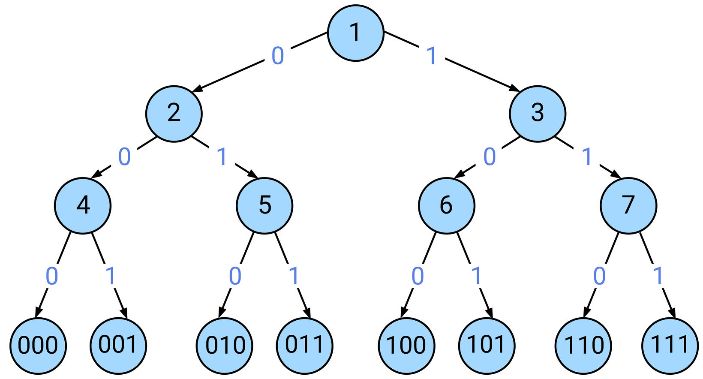

# Группа III, № 5. Дерево непринятия решений

## Условие задачи

Оригинальная задача муниципального этапа ВсОШ по ИИ 2025/26 для 9–11 классов, вариант III. Двенадцатая задача в согласованном порядке подготовки.

Источник: [МЭ25_ИИ_9-11_Группа_3_Текстовый_разбор.pdf](<../../../../2025-2026/01_Школьный и муниципальный этап/Муниципальный этап/МЭ25_ИИ_9-11_Группа_3_Текстовый_разбор.pdf>), с. 3–4 — условие, схема и пример; с. 4–5 — разбор и код на C++. [Официальная страница архива](https://siriusolymp.ru/2025/municipal/ai).

Ограничение по времени: 1 секунда.

Ограничение по памяти: 256 мегабайт.

В машинном обучении часто используют деревья решений. Каждая внутренняя вершина такого дерева соответствует некоторому вопросу, а каждое ребро — выбору ответа (да/нет). Таким образом, за несколько вопросов исходные данные могут быть разбиты на достаточно большое количество классов. Очередным проектом для Димы стало дерево непринятия решений. Его структура похожа на структуру решающего дерева. Это полное бинарное дерево глубины $n$. В каждой вершине, кроме вершин последнего уровня, хранится число $p$ ($0 \leq p \leq 100$). Это число обозначает вероятность выбора: с вероятностью $p$ процентов алгоритм выберет пойти влево и, соответственно, с вероятностью $100-p$ процентов — вправо.

Договоримся: движение влево обозначим цифрой 0, а движение вправо — цифрой 1. Таким образом, каждая вершина нижнего уровня соответствует двоичной строке длины $n$ (последовательности решений от корня до листа).

Вероятность получения этой строки равна произведению вероятностей всех выборов, сделанных на пути от корня до листа.

Дима уже написал структуру для такого дерева и хочет протестировать её. Для этого он создал дерево глубины 3. Значит, всего в нём 7 внутренних вершин. Каждая вершина имеет своё число $p$. Ниже показана схема расположения этих вершин:



Найдите вероятности всех двоичных строк длины 3 и выведите их в порядке неубывания вероятности. Если вероятности совпадают, строки должны выводиться в лексикографическом порядке.

**Формат входных данных**

В первой строке заданы 7 целых чисел $p$ ($0 \leq p \leq 100$) — вероятности для вершин, как показано на рисунке.

**Формат выходных данных**

Выведите 8 строк. Каждая строка должна содержать двоичную строку длины 3. Строки должны идти в порядке неубывания вероятности. При равенстве вероятностей строки сравниваются лексикографически.

**Пример**

Стандартный ввод:

```text
40 90 20 90 100 70 0
```

Стандартный вывод:

```text
011
110
001
101
010
100
000
111
```

**Замечание**

В первом тестовом примере двоичные строки имеют следующие вероятности:

- `011` — $0{,}0$;
- `110` — $0{,}0$;
- `001` — $0{,}036$;
- `101` — $0{,}036$;
- `010` — $0{,}04$;
- `100` — $0{,}084$;
- `000` — $0{,}324$;
- `111` — $0{,}48$.

Максимальный балл за задание в исходном комплекте 2025/26 — 100. Это исторические сведения об этой задаче, а не подтверждённая шкала муниципального этапа 2026/27.

## Простое объяснение

Представь лабиринт с тремя последовательными развилками. В каждой развилке можно пойти налево или направо. Путь `001` означает: налево, ещё раз налево, затем направо. Последняя вершина пути называется листом дерева.

Номера 1–7 на рисунке обозначают вершины, а входные числа $p_1,\ldots,p_7$ задают вероятность пойти влево в каждой из них. Например, путь `000` проходит через вершины 1, 2 и 4. Для движения вправо в вершине 4 берётся вероятность $100-p_4$ процентов — так получается путь `001`.

Неубывание вероятности означает порядок от самых редких путей к самым вероятным. При равенстве сравниваем сами строки слева направо: 0 идёт раньше 1. Вывести нужно все восемь путей, включая пути с нулевой вероятностью.

**Маленький готовый пример — учебные значения вероятностей**

Запусти `example.py` и введи:

```text
50 50 50 20 50 50 80
```

Для пути `000` получим:

$$
P(000)=\frac{50}{100}\cdot\frac{50}{100}\cdot\frac{20}{100}
=\frac{50\cdot50\cdot20}{1\,000\,000}
=0{,}05.
$$

У всех путей одинаковый знаменатель $100^3=1\,000\,000$, поэтому для сортировки достаточно сравнивать целые числители. Так равные вероятности сравниваются точно. В коде сначала выписаны восемь произведений, затем созданы пары «числитель, строка» и вызван `paths.sort()`: пары сравниваются сначала по числителю, а при равенстве — по строке.

Для учебного входа итоговый порядок: `000`, `111`, `010`, `011`, `100`, `101`, `001`, `110`. Программа перед ответом показывает числители всех восьми вероятностей. Способ соответствует разбору исходной задачи; дерево всегда имеет глубину 3.

**Вариант с циклом — по просьбе ученика**

В `example_loop.py` отдельные переменные для восьми путей заменены циклом. Числа от 0 до 7 превращаются в трёхсимвольные коды через `format(number, "03b")`. Затем программа проходит три развилки по цифрам каждого кода и перемножает соответствующие проценты. На той же строке ввода можно сравнить результат с `example.py`.

По нумерации исходной схемы у вершины $v$ левый ребёнок имеет номер $2v$, правый — $2v+1$. Например, из вершины 1 получаются 2 и 3, а из вершины 2 — 4 и 5. Нулевой элемент списка вероятностей не используется, поэтому индекс списка совпадает с номером вершины. Промежуточный вывод показывает посещённые внутренние вершины и числитель вероятности каждого пути.

**Как это будет на платформе**

В исходной задаче 2025/26 это программное задание. Программа получает одну строку из семи целых чисел: $p_1,p_2,\ldots,p_7$ в порядке номеров на рисунке. Скачиваемого файла данных нет.

Для нашей практики используется Python 3 и обычный `.py`. Отправляется программа, которая выводит ровно восемь двоичных строк по три символа, каждую с новой строки. Сами вероятности выводить не требуется. Перед сдачей убрать поясняющую печать числителей или посещённых вершин и заголовок «Ответ:»; оставить чтение, вычисления, сортировку и последний цикл, печатающий только коды путей.

Точные условия площадки муниципального этапа 2026/27 ещё не подтверждены; школьные правила отправок автоматически сюда не переносим.
