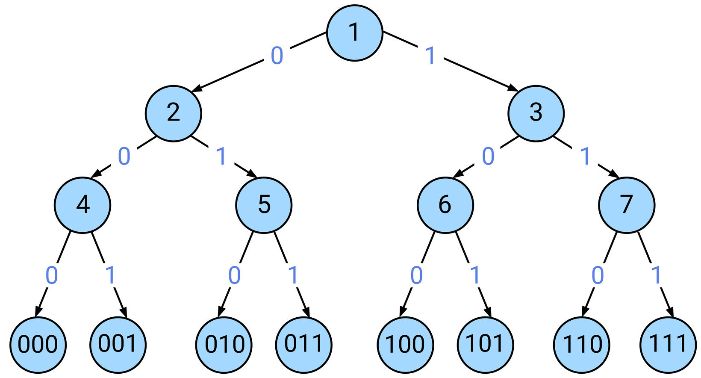

# Учебная модификация № 1. Ветры парящих островов

## Условие задачи

Это придуманная учебная модификация, не официальная задача олимпиады.

Основа: группа III, № 5 «Дерево непринятия решений», муниципальный этап ВсОШ по ИИ 2025/26, 9–11 классы; [исходный PDF](<../../../../../2025-2026/01_Школьный и муниципальный этап/Муниципальный этап/МЭ25_ИИ_9-11_Группа_3_Текстовый_разбор.pdf>), с. 3–5. Сохраняются три развилки, семь вероятностей в процентах, вычисление вероятностей путей и сортировка. Изменение: несколько путей могут приводить на один остров, поэтому требуется найти общую вероятность каждого конечного пункта. Это учебное изменение обработки результатов знакомого дерева, не прогноз варианта 2026/27.

Воздушный корабль отправляется между парящими островами. На его пути три последовательные развилки. Полная схема маршрутов совпадает с деревом:



В каждой внутренней вершине $v$ задано целое число $p_v$ — вероятность пойти налево в процентах. Вероятность пойти направо равна $100-p_v$ процентов. Движение налево обозначается 0, направо — 1. Вероятность маршрута равна произведению вероятностей его трёх выборов.

Каждый из восьми маршрутов заканчивается на острове с заданным номером. Разные маршруты могут приводить на один и тот же остров.

Найдите общую вероятность прибытия на каждый остров, указанный во входных данных. Расположите острова по неубыванию этой вероятности. При равенстве вероятностей раньше должен идти остров с меньшим номером.

Вероятность каждого острова представляется дробью

$$
P(\text{остров }d)=\frac{W_d}{1\,000\,000}.
$$

В ответе требуется вывести целый числитель $W_d$. Знаменатель общий, потому что каждый маршрут содержит ровно три выбора в процентах. Все указанные во входе острова должны присутствовать в ответе, включая острова с нулевой вероятностью прибытия.

**Формат входных данных**

В первой строке заданы семь целых чисел $p_1,p_2,\ldots,p_7$ ($0 \leq p_v \leq 100$) в порядке номеров вершин на схеме.

Во второй строке заданы восемь целых чисел $d_1,d_2,\ldots,d_8$ ($1 \leq d_i \leq 1000$) — номера островов для маршрутов в следующем порядке:

`000`, `001`, `010`, `011`, `100`, `101`, `110`, `111`.

**Формат выходных данных**

В первой строке выведите количество различных островов, указанных во входе.

Затем для каждого такого острова выведите отдельную строку с двумя целыми числами через пробел: номер острова $d$ и числитель его общей вероятности $W_d$.

Строки должны идти по возрастанию $W_d$, а при равенстве — по возрастанию номера острова. Каждый остров выводится ровно один раз.

**Пример 1**

Ввод:

```text
50 50 50 20 50 50 80
4 9 4 9 2 2 4 9
```

Вывод:

```text
3
2 250000
4 375000
9 375000
```

**Пример 2**

Ввод:

```text
50 50 50 50 50 50 50
7 7 7 7 7 7 7 7
```

Вывод:

```text
1
7 1000000
```

## Простое объяснение

Один остров может принимать корабли с нескольких разных маршрутов. Теперь нас интересует вероятность прибытия на остров целиком, поэтому нужно учесть все ведущие к нему пути.

Коды маршрутов по-прежнему помогают пройти дерево, а в ответе перечисляются конечные острова. Числитель 250000 означает вероятность $\frac{250000}{1000000}=\frac14$, то есть 25%. Остров с числителем 0 тоже остаётся в отчёте, если он указан во входе.

**Как это будет на платформе**

Это домашнее упражнение без страницы в официальном туре. Для учебной проверки сохраняй программу в обычном `answer.py`: вход — две строки с вероятностями и номерами островов; выход — число различных островов и затем строки «номер острова, числитель» в требуемом порядке. Во время решения можно печатать промежуточные значения; при подготовке к проверке оставить только требуемый результат.

В исходной официальной задаче 2025/26 на входе только семь вероятностей, а на выходе восемь кодов маршрутов. Точные условия площадки муниципального этапа 2026/27 ещё не подтверждены.
